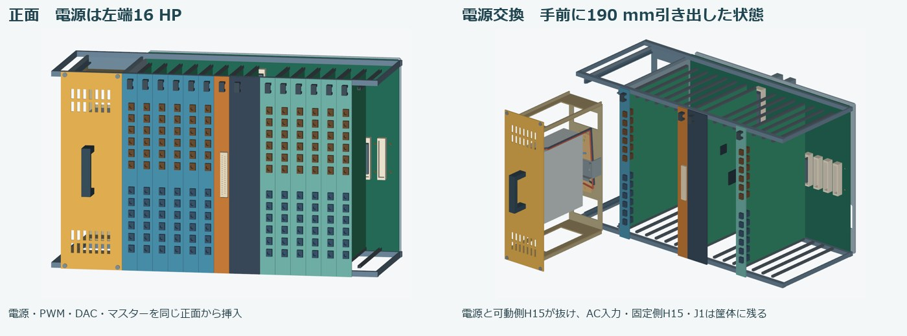

# 6Uクレートの前面着脱式電源と4 HPカード配置

[8 HPマスター前面I/Oの実寸配置（光16口・電気4口）](../master_8hp/README.md)

正面左の16 HPを12 V電源専用ベイに割り当てる。電源カセットを抜くと、電源本体とオスH15が手前へ移動し、AC入力、筐体PE、メスH15、J1行きのDC配線はクレートに残る。

[3D組立・交換手順・取付寸法（PDF、6ページ）](PSCONT_front_PSU_views.pdf) · [回転できるオフライン3Dビューア（ZIP）](PSCONT_front_PSU_viewer.zip) · [組立CAD（STEP入りZIP）](PSCONT_front_PSU_STEP.zip)

ビューアはZIPを展開してHTMLをChromeまたはEdgeで開く。正面、電源内部、背面、引き出し、ソケットの5視点がある。STEPは嵌合状態の組立で、背面側から見たときは電源が右に見える。

## 正面の割付と信号基板

| 左から | 幅 | 内容 | ピッチ基準からの範囲 |
|---|---:|---|---|
| 左端 | 2 HP | 端部余裕 | 0～2 HP |
| 電源 | 16 HP | 81.28 mm。カセット専用ガイドと専用H15 | 2～18 HP |
| C1～C6・X1 | 28 HP | コンバータ用PWM 6枚、DAC 1枚 | 18～46 HP |
| M | 8 HP | STM32H745＋MAX 10マスター、上下2コネクタ | 46～54 HP |
| H1～H6・X2 | 28 HP | チョッパ用PWM 6枚、予備1枠 | 54～82 HP |
| 右端 | 2 HP | 端部余裕 | 82～84 HP |

信号群64 HPの中央にマスターを置く。左の7枠をJ2、右の7枠をJ3に接続する。マスターから最遠ソケットまでのb列の水平差は162.56 mm。キャリアの同期・山谷ラッチにはREFCLKとSYNCを使う。全14枠の信号割当は[差動対112組の表](proposed_links.csv)に記載した。マスターからMAX 10までのduty転送はSPIを使い、FMCはSDRAM用とする。

PCBと背面支持板の左端を電源区画との境界に合わせ、幅を425.28 mmから334.56 mmに変更する。信号PCBの後ろにAC配線を通す必要がなくなり、電源コネクタの挿抜荷重を独立した後面金具で受けられる。

| 機械基準 | 提案値 |
|---|---|
| 座標 | Xは旧基板の左端、Yは旧基板の上端。新PCBのローカルX＝X−90.72。DXFは同じX、Yは下端から上向き。ZはPCBの背面から正面に向かって正 |
| 電源区画・隔壁 | X＝9.44～90.72。固定隔壁X＝88.70～90.20。旧基板に対する84 HPピッチの左端X＝−0.72 |
| 信号基板・支持板 | X＝90.72～425.28、334.56 × 262.05、四隅C2。PCB t1.6、A5052支持板 t3、間隔10 |
| ソケットb列のX | C1＝98.64、X1＝220.56、マスター＝240.88、H1＝281.52、X2＝403.44。共通スロットのピッチ20.32 |
| 支持 | M3支柱36本、レール固定穴18点、支持板の先付け穴4点。12 × 30 × 246の補強角棒2本、中心X＝241.64・268.64 |
| カード | 奥行160を仮定。前板内面Z＝176。PWMは光出力6・ゲートエラー入力6。X2はソケット・ガイドだけを表示 |

[PCB配置DXF](pcb_placement_front.dxf) · [支持板DXF](support_plate.dxf) · [取付・部品座標CSV](coordinates.csv) · [電源板金DXF](psu_cassette.dxf) · [候補部品と購入先CSV](parts.csv)

## 電源カセットと固定金具

- **可動側**　前板と取手、開口を設けた上下棚、後板、DIN支持ブリッジ、長さ66 mmのTS35/7.5、電源本体、H15オスと内部配線を一体化する。前板の脱落防止ねじ4本で着座位置を保持する。電源は縦置きで、DINレールを左右方向に取り付ける。
- **固定側**　上下ガイドで重量を受け、専用後面金具にメスH15、背面にACインレットを取り付ける。コネクタのリードイン、誤挿入防止キー、嵌合終端ストッパ、端子カバーを設ける。取付公差・許容フロートはコネクタの製作図と実機で決める。H15はメーカー記載で挿入・引抜力各最大90 N。ガイドと独立後板のたわみ・位置ずれをこの荷重で確認する。
- **通風**　本体40 × 125.2 × 113.5 mm。モデルの上下棚と本体間は上43.8、下48 mm。ケース側面から側壁まで約13 mm以上。配索は上下の吸排気面をできるだけ外し、隣に発熱体を置く場合はメーカー推奨15 mmを確認する。上部・下部の開口を既設クレートの吸排気につなぐ。
- **保守**　上位のAC電源を遮断して施錠等で再投入を防ぎ、AC・DCの無電圧、残留電圧と外部からの逆給電がないことを確認する。前板ねじを解放し、取手を持って真っすぐ引く。190 mmでカセットが前板面を越えて抜ける。取手は前板外面から28 mm突出するため、既設扉の閉鎖余裕と作業者の手の空間を別に確認する。再挿入・前板固定後にPE導通を確認し、復電する。H15の負荷開閉・活線挿抜は禁止。

## AC、保護接地、12 V

| H15接点 | 回路 | 接続 |
|---|---|---|
| z32（先行） | PE | 固定筐体のPEスタッド → カセットPEスタッド → 電源FG。固定筐体はインレットPEに常時直結 |
| z28、z24 | AC L、N | 上位分岐保護・遮断器 → 固定インレット → H15 → 電源のL、N |
| z4・d6・z8 | +12 V | 電源出力 → 3極並列 → 固定側ハーネス → J1の+12 V |
| d10・z12・d14 | 0 V | J1の0 V → 3極並列 → 電源の0 V |
| 他6極 | 未配線 | d18・z16・z20・d22・d26・d30。AC・DCの端子束を物理的に分ける |

可動側 HARTING 09060152931 と固定側 09062152871 を候補にした。ともに15極、Faston、接点定格15 Aは20 °C条件。先行接点はオスのz32。固定側端子を覆い、カセットを抜いた状態でも充電部に触れられない構造とする。沿面・空間距離は接点間に加え、圧着端末・配線・板金・接地部まで、使用電圧、過電圧カテゴリ、汚損度、要求する絶縁の種類に応じて確認する。DCの0 VとPEの接続点は既設盤設計に合わせる。上位遮断器の定格は既設分岐・突入・電線保護に合わせて確定する。

マスター1.25 A、PWM 12枚で6.00 A、DAC 0.60 Aの合計は7.85 A（94.2 W）。予備への0.60 A込みで8.45 A（101.4 W）。12 V・10 AのSDR-120-12に対して公称余裕は18.6 W。最低AC入力と最高温度によるディレーティングは[電源仕様](https://www.meanwell.com/Upload/PDF/SDR-120/SDR-120-SPEC.PDF)による。

電源端から最遠カードまでの往復目標は0.30 V。2.5 mm²・往復1 mの線材、F1、Q1、枝ヒューズの従来見積は計203 mV。H15の接点抵抗を各8 mΩとすると3極ずつの往復は5.33 mΩ、8.45 Aで約45 mV、両極合計約0.38 W。合計248 mV、残り52 mVを端末・分岐・銅箔・温度上昇に配分する。配線長の1 mには固定・可動両方を含める。並列枝は同長・同断面で分岐して接点ごとの電流と温度を測定する。単線1極ずつでは約135 mV追加となり、従来見積との計338 mVが目標を超える。

[電源メーカー図面・定格](https://www.meanwell.com/Upload/PDF/SDR-120/SDR-120-SPEC.PDF) · [H15オス・先行接点・接触抵抗・機械特性](https://www.harting.com/en-CL/p/DIN-Power-H15MT-1C1-1-09060152931) · [H15メス・コーディング・定格](https://www.harting.com/en-PL/p/DIN-Power-H015FTC1-1-09062152871) · [DAC電力計算と信号・保護回路の根拠](../dac_4hp/README.md)

## 図面の適用範囲

本版は部品配置・板金の検討案。PCB外形・取付座標・支持板はこのフォルダのDXFとCSVに反映した。KiCadのPCB本体と回路図は先行する6 HP版で、4 HP・14枠への反映および配線は別工程。X1/X2の増設用ピンは旧マスターでは一部がGNDのため、改版マスターと組で運用する。

DXF再読込み、カード16コネクタの外形間隔、支持点36箇所とコネクタの間隔、背面37部品の外形と点検窓、112組の差動対の重複を計算で確認した。FreeCADでSTEPを書出して再読込みし、カセットの外形と隣接区画のX方向のクリアランス、190 mmの抜き代を確認した。光口、DAC前面口、ガイド、H15シェル・端子、ACインレット、配線は概形。試作発注前に実クレートのレール位置、DIN係止の着脱、整合する端子・絶縁カバー、配線曲げ半径、板金たわみ・通風、接地・絶縁・電圧降下を照合する。
