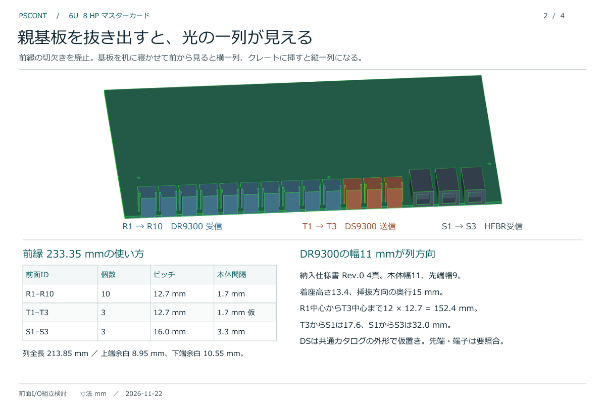

# 6U・8 HPマスター前板　光素子16個の親基板直付け

[親基板と4枚の3D組立図](interconnect/master_front_interconnect.pdf) ｜ [前板の原寸PDF](master_8hp_panel_fit.pdf) ｜ [組立STEP](interconnect/assembly_3d/master_8hp_STEP.zip) ｜ [オフライン3Dビューア](interconnect/assembly_3d/master_8hp_viewer.zip) ｜ [前面座標CSV](front_io_centres.csv) ｜ [基板・配線・部品割付の詳細](interconnect/README.md)

親基板Mの233.35 mmの前縁にDR9300×10、DS9300×3、HFBR-24E6Z×3を同一面・同一前縁に直接実装する。搭載姿勢では前板の左側に光が縦一列に並ぶ。右側はPLC 2口、RJ45、DE-9。カード全体はM、演算子C、Ethernet E、PLC中継Pの4種類・各1枚。

## 列方向の寸法

正面から見て前板左上をX=0、Y=0、幅40.34、高さ260.45 mmとした。Mの前縁範囲はY13.55～246.90、部品面はX8.57。Xは筐体外形の中点で、光軸位置は別途図面・現物で決める。

| 部品と数量 | Y中心 mm | 列方向の本体幅 mm | 同種間の本体隙間 mm |
|---|---|---:|---:|
| R1～R10　DR9300 ×10 | 28.0から12.7ピッチ、最後は142.3 | 11.0 | 1.7 |
| T1～T3　DS9300 ×3 | 155.0、167.7、180.4 | 11.0（カタログ） | 1.7 |
| S1～S3　HFBR-24E6Z ×3 | 198、214、230 | 12.7 | 3.3 |

DR9300納入仕様書Rev.0、4頁の本体幅(11)、先端幅(9)、奥行15、着座高さ(13.1)＋0.3＝13.4を採用。前板を通る先端は(7.1) mmの区間で幅(9)。F06の筐体の公称隙間は1.7 mm、先端間は3.7 mm。DSはカタログの三辺がDRと共通で、段差はDR形状を仮置き。HFBRはBroadcomのSCポート外形12.7 × 28.65 × 10.38 mm。端子・ドリルは各品番の資料による。[日立HyLinkカタログ](https://www.hitachi-ite.co.jp/products/catalog/pdf/hylink.pdf)・[Broadcom SCポート外形](https://www.mouser.com/datasheet/3/57/1/AV02-0176EN_2025-04-05.pdf)

列全体の端はY22.50と236.35 mm、全長213.85 mm。Mの端まで上8.95、下10.55 mm残る。上側のF06と下側のSCでは着座高さが異なり、同じ基板面に付けても外形の中心Xは15.27と13.76 mmになる。

## 前面ケーブル・挿抜

| 仮の外形（横X × 縦Y mm） | 最も近い枠 | 公称の隙間 |
|---|---|---:|
| F06プラグ 16 × 12 | 次のF06プラグ | 0.70 mm |
| PLC（レバー全開）16 × 63.8 | 横のF06 | 0.73 mm |
| RJ45 18 × 20 | 横のSC（14.5角） | 0.81 mm |
| DE-9フード 19 × 35 | 横のSC（14.5角） | 0.14 mm |

0.14 mmは寸法公差や指掛かりを含まない。現場のF06のラッチ・ブーツ、SC、DE-9フードを同時に装着し、隣を挿したまま抜けるかを確認する。現用フードが広い場合は薄型フードの適合可否、または開口配置を見直す。光軸と前後の突出量、実機クレートのガイド・ハンドル、端部の取付穴、前板への着脱荷重の伝達も確認して加工図を確定する。原寸図はA4、倍率100 %で印刷。右下の50 mmゲージで確認できる。

PLCヘッダー2個はHIF3B-20PA-2.54DS(71)想定。中心Y51.2と116.7、全開長63.8でレバー枠間1.7 mm。RJ45はMolex 93463-5206、DE-9は現行ケーブルに合わせる。HFBR入力は既設TEP521CのS1相当を3個仮定する。[既設インターフェース](https://github.com/kurimoto-ps/jparc-fb-board/blob/8ffc1ff86d3a8252b1c35c7859f049dd370dface/docs/interfaces.md)

座標・前板外形は機構検討の公称値。公差入りの製作図・穴明けテンプレートは別途作成する。
