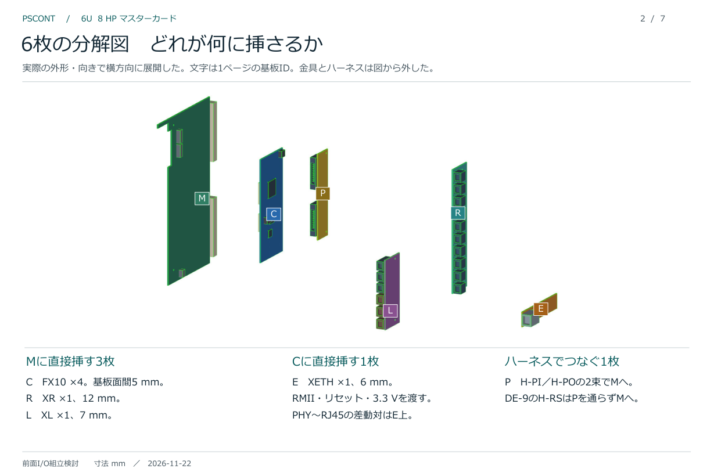

# 6U・8 HPマスター　演算子基板と前面I/Oの接続案

[3D組立図・基板別外形・ハーネス配線（PDF・7ページ）](master_front_interconnect.pdf) ｜ [回転・分解できる3Dビューア（ZIP）](assembly_3d/master_8hp_viewer.zip) ｜ [組立STEP（ZIP）](assembly_3d/master_8hp_STEP.zip) ｜ [基板台帳（CSV）](assembly_3d/board_register.csv) ｜ [内部端子割付案（CSV）](interconnect_pins.csv) ｜ [前板の実寸図](../README.md)

**マスターカード1台は6種類・各1枚、計6枚。新規5種類（M・R・L・E・P）と既存設計の改版1種類（C）を作る。** 6枚で8 HPを占める。PはJ3・J4を両方載せる1枚の受動基板。RS-232Cは前板固定のはんだカップ型DE-9を配線するので基板は不要。クレート側バックプレーン、PWM・DAC各カードはこの台数に含まれない。

**組み合わせ**　M ↔ C は既設FX10の4組、M ↔ R・M ↔ L は各1組、C ↔ E は1組。P ↔ M はPLCハーネス2束、DE-9 ↔ M はRS-232Cハーネス1束。外部接続口の荷重は前板裏の支持金具に受ける。Mに嵌合する部品はクレート背面のプラグとは別。

3DビューアはZIPを展開し、HTMLをChromeまたはEdgeで開く。「組立」「前板を外す」「6枚に分解」「3束の配線」「前板支持金具」「旧子との干渉」と6枚それぞれの単品図を選べる。STEP内の基板IDはPDF・端子表のIDと共通。STEPの座標は (X, D, 260.45−Y) mm。光素子などの外形は収容確認用。製造向けランド・穴位置の決定にはメーカー図と相手プラグの照合が必要。

## 親基板と演算子基板

| 基板 | 載せるもの | 境界を渡すもの |
|---|---|---|
| 演算子基板 C（既設改版） | STM32H745XIH6、10M16DCF484I7G、SDRAM、電源、SPI1～4、デバッグ端子。FX10の子側J7～J10のパターンと対応を維持 | 親へ既設FX10×4、Ethernet基板Eへ新設XETH×1。FMC16は従来どおりSDRAM専用 |
| 新しい親基板 | バックプレーンの12 V受電・3.3 V/5 V生成、クロック、LVDS、トリップ集約、PLC絶縁入出力、ADM3202とチャージポンプ | 子C、左右の光基板、前板ハーネス3束。PWM・DAC指令およびゲートエラー帰還は背面。ゲート停止はPLC・UART・Ethernetの処理時間に依存させない |
| 右・光受信基板 R | DR9300×10と5 V受信系、3.3 Vへのレベル変換・デカップリング | 親へXR。ADC24の3組各3本＋ADC16の戻り1本。短い3.3 V単端経路で親から子J10へ |
| 左・光基板 L | DS9300×3と送信駆動系、HFBR-24E6Z想定×3と受信・整形系 | 親へXL。子J9から送信3本、子J7ほかへ整形出力3本。送信駆動とアナログ受信の電源帰路・配置を分ける |
| Ethernet基板 E | LAN8742A、25 MHz水晶、ストラップ・バイアス・フィルタ、Molex 93463-5206、LEDと周辺 | XETHでCに直接接続。3.3 VのRMII・管理・リセット。差動MDIはE基板内で完結 |
| PLC中継基板 P（1枚）・独立DE-9（基板0枚） | J3/J4は従来型HIF3Bを受動中継板に載せ、前板金具に固定。DE-9もねじ固定 | PLCは別々の20極、RS-232Cは専用ハーネス。外部コネクタの着脱力を内部の圧着端子やFX10で受けない |

Cの改版範囲はEthernet回路の移設、既存子J1・J3の移設、STDC14のキーと1番ピンの是正、読めるシルクへの修正。J5のガイド穴は移設先Eでメーカー図に合わせる。旧子基板の試作実績を比較基準に、STM・FPGA・SDRAM間の配線と電源回路の変更を抑える。新しい親側コネクタは旧子基板も装着できる配置とする。新旧のピン電圧・出力方向・ストラップが一致することを確認してから、旧子基板で光・PLCを単独試験できる。

## 前板ハーネス

| 外部コネクタ | 前板から親まで | TEP521Cから引き継ぐ接点 |
|---|---|---|
| 母J3、PLC DO → マスター入力 | 前面HIF3B-20PA-2.54DS(71) → 受動板 → H-PI 20芯 → 親の入力抵抗・PS2801C-4系 → 子J8 | 1～16が各点、17～20は既設図の「+24V」共通。各ピンを同番号で結線し、共通4接点も残す |
| 母J4、マスター出力 → PLC DI | 子J8 → 親のG3VM-41HR系接点 → H-PO 20芯 → 受動板 → 前面HIF3B | 1～16が各点、17～20は既設図の「-24V」共通。J3とは別キー。±の呼称は既設図のネット名で、親のロジック電源を基準とする電圧指定ではない |
| 母J5、RS-232C（外部はDE-9メス） | 子J8 → 親のADM3202 → H-RS → 前面DE-9。ねじは既設プラグに合わせる | マスターから見て2=RXD入力、3=TXD出力、5=SG、7=RTS出力、8=CTS入力。1/4/6/9は未接続。7/8は別線で引き、既設の子J8-66/68側のフロー制御折返しを維持 |

H-PI/H-POはラッチ付圧着、同一筐体を用いる場合も異なる誤嵌合キーで区別する。現場側の20極プラグおよび番号を保存。H-RSは9極ハウジングに有効5線を実装し、端子番号は前面DE-9と対応させる。SGはADM3202側の信号基準へ戻す。DE-9金属シェルは前板シャーシで受け、SGとの結合は盤の接地仕様に合わせる。PLCのフィールド共通線はロジックGNDから分離。3Dモデルの端点間中心線長はH-PI 32.6、H-PO 73.4、H-RS 69.2 mm。PLCは親基板面に平行な16 × 4.2 mmの束、RSは直径3.3 mmを仮定。線材・端子を選んで曲げ半径、挿入代、クランプ位置と引出し余長を足した値をハーネス製作長とする。前板側金具で束をクランプし、親の前縁に沿わせ、光開口・上下ガイド・Cのデバッグ端子を横切らせない。電線サイズ・圧着端子・接点定格はPLCの共通線最大電流と既設電線によって確定する。

親側コネクタの配置候補（Y, D。mm）はH-PI (44, 60)、H-PO (64, 60)、H-RS (238, 68)。H-POは浅い位置を上へ戻し、端子を演算子基板の下に隠さない。H-RSは右列のままD52まで進み、左光基板の後端D44を過ぎてから幅方向に親へ渡す。PDF第4頁に端点と配索を示す。H-POの縦走区間をD24付近に通し、XRの前側を迂回する。

## 光信号

| 前面 | 光素子 | FPGA側の既設接点 |
|---|---|---|
| R1/2/3 | DR9300、ADC24-1のDRDY/DATA/SCLK | 子J10-18/20/22 |
| R4/5/6 | 同、ADC24-2 | 子J10-26/28/30 |
| R7/8/9 | 同、ADC24-3 | 子J10-34/36/38 |
| R10 | DR9300、ADC16の8 ch直列戻り ADDATA16 | 子J10-44 |
| T1/2/3 | DS9300、ADC16へのSCLK/FS/CONVSTART | 子J9-58/60/62 |
| S1 | HFBR受信、既設の光クロックを継承 | 受信整形後に子J7-75（ACC_12MHZ） |
| S2/3 | 増設HFBR受信2口 | XLに2本を確保。信号種別・パルス幅・無信号期間を設備側と合わせて子接点を確定。クロック用途なら専用クロック入力と制約を確認 |

TEP523Aの受信バッファ、TEP526Aの送信駆動、TEP521Cの光クロック入力をそれぞれ前面基板へ寄せる。旧母J6のHFBR-24E6Zはアナログ出力で、既設回路はC35でAC結合している。S1はこの受信器・整形段まで移す。S2/S3が単発イベントや長い静止レベルを伝える場合には、対応する光送受信の形式と無信号時レベルを確認して回路を決める。生の受信アナログ出力を親に伸ばさない。R上で3.3 V化し、各ADC24のSCLKとDATA間の遅延差を受光器・バッファ・親・FX10まで含めて評価。XR/XLは信号隣接GNDを設け、駆動側に直列ダンピングの実装位置を用意する。電源の割付本数は全チャネル消費電流・接点温度上昇・許容降下で最終決定する。

### 光素子の寸法照合

| 部品／用途 | 前板への本体投影 X × Y（mm） | 挿抜方向の奥行 D（mm） | 寸法の扱い |
|---|---:|---:|---|
| 日立 DS9300／DR9300、F06、T1–T3／R1–R10 | 11 × 13.4（仮） | 15（仮） | メーカー公表は三辺11 × 15 × 13.4 mm。「サイズ」欄に軸名は記載されていない。外形の軸対応、光軸と端子面は要照合 |
| Broadcom HFBR-24E6Z、SC、S1–S3 | 10.38 × 12.7 | 28.65 | SC外形図（12頁）を今回の立てたカードに投影。取り付けピンは除く |
| Broadcom HFBR-1522ETZ／2522ETZ、PWMカード用 | 約7.6 × 12.2（同じ基板姿勢の場合） | 18.8 | 横型の機構図（4頁）。幅は10.2 mmに連結突起2.0 mmを含む。マスターカードへの搭載はない |

旧版の3D本体はX・Y・D＝11・15・15 mmで、日立の13.4 mmの辺が欠けていた。修正版では公表された三辺を使用。前板の操作枠16 mm角は設計上の割付。光軸高さ、開口寸法、推奨ランド・プラグの操作余裕はこの三辺から確定できない。図示の向きで右列17.4 mmピッチから本体の13.4 mmを引くと隙間4.0 mm。16 mmの操作枠どうしは1.4 mm。PDF第7頁に同一縮尺で正面・側面を示す。[日立HyLinkカタログ2頁](https://www.hitachi-ite.co.jp/products/catalog/pdf/hylink.pdf)・[Broadcom SCポート外形](https://docs.broadcom.com/doc/AV02-0176EN)・[Broadcom PWM用横型外形](https://docs.broadcom.com/doc/AV02-3283EN)

## Ethernetの配置と改版

演算子基板に現行J5を直付けする場合、親基板中心面X=7.77、親・子板厚1.60、既設FX10嵌合高さ5.00、ジャック筐体高さ14.10 mmと仮定すると、筐体中心はX=7.77+0.8+5+1.6+14.1/2=22.22 mmとなる。目標の右列X=30.15との差は7.93 mm。仮にこの中心にジャックを前出しした場合、既設前板の操作枠では左T1と幅4.93×高さ14.2 mm重なる。単に子基板のJ5を前縁へ動かすだけでは解決しない。

Eを子Cの部品面から6 mm離して平行に載せると、同じ仮定で筐体中心はX=29.82 mm。目標差0.33 mmはコネクタ筐体の中点を使った計算で、嵌合軸の公差ではない。RJ45ラッチ・パネル厚・ガイドピン・支持脚をメーカー図と現品で合わせる。Eから前面金具へ支持を取り、コネクタの嵌合方向（X）に組んでから金具を締める。スロットからは組立体ごと抜く。長穴は組付け時の位置調整用とし、締結時にB2Bへ無理な予圧を掛けない。

Eに旧Ethernet回路を一括移設する。Cとの間はXETH 60極のうち、RMII 50 MHz基準・RXD[1:0]・CRS_DV・TX_EN・TXD[1:0]、MDC・MDIO・nRSTで10信号。GNDと3.3 Vも渡す。PHYがREF_CLKをSTMへ供給する既設方式、PHYアドレス・MODEストラップ、リセット、LED、RBIASを継承する。R105などPHY出力の直列抵抗はEの送端へ。STM側の出力にも必要に応じて送端抵抗のランドを取る。XETHからPHYまでの信号長と負荷を抑え、特にPHY→STMのクロックとSTM→PHYの送信データの往復を含めて最小／最大のsetup・holdを確認する。MDI差動対はE内で100 Ω差動を目標に連続した参照面上を配線し、絶縁部の銅箔除外・シャーシ境界はジャックとPHYの推奨に従う。

**旧子基板との干渉**　旧J1（HRTIM出力・FLT5）の中心はY207/D70.4、旧J3（STM32 ADC3入力）はY200/D84.6。どちらもEの投影内にある。未嵌合XHヘッダーの高さ約7 mmに対し空きは6 mm。今回の改版Cでは両コネクタの電気機能を保持したままEの外へ移設する。移設先の座標・配線は未決で、STEPは移設先のヘッダーを省略している。旧子で先行試験する時はEを装着せず、旧子自身のEthernetを使う。

右光基板RとEは別体にする。Rは親と、Eは演算子Cと嵌合するため、1枚に連結すると4個の既設FX10を含む複数箇所に同時に位置決めされる。別体なら各基板と前板金具の位置を個別に調整できる。

既存子基板を無加工で使う比較案は、子のJ5を残し、トランスを追加しない前板RJ45中継と短いシールド付きパッチコードで結ぶ方式。嵌合プラグ、ラッチ操作、曲げ半径、余長固定まで8 HP内に実装できれば、Ethernetの電気的な改版は不要。初号機で既設子基板の流用を最優先する場合の選択肢となる。

## 寸法と組立

座標は前板正面の左からX、上からY、前板内面から後方へD。単位mm。側面図の外枠は前板高260.45×想定奥行160の組立空間で、親基板の製造外形は表さない。CのF.Cu面を+X側に向けて長辺を縦にする。旧CADの座標 (x,y) を Y=75+(x−36)、D=48+(121.10−y) に写す案。板外形145.05×68.40とFX10の相対位置を保存し、親側フットプリントは嵌合面の1番を照合して配置する。

| 配置対象 | Y・D寸法案 (mm) | 固定・宿題 |
|---|---|---|
| 親M・PLC受動P | MはY13.55～246.90、D0～160の外枠。PはY24～145、D0～31。背面プラグ案はD170.9まで | Mの切欠きはY19から下端までD32、PLCの束が親に近づくY31～81だけD42。上部のガイド先端を残し、下部はD32以降でガイドを受ける。PにJ3とJ4を各1個搭載。 |
| 演算子C | Y75～220.05、D48～116.40。親のJ7/J8相手中心 (166,102.1)/(166,58.1)、J9/J10相手 (125,102.1)/(125,58.1) | 160 mm奥行モデルで後方43.6 mm、光板D44までとの間は4 mm。いずれも基板投影。背面コネクタ・ハンダ突起・ヒートシンク等は別途確認 |
| R | Y15～189、D0～44。XR中心例 (95,38)、親の部品面から12 mm案 | 光軸の公差を現物合わせ。前板金具で両端支持。右前列に全10受信口 |
| L | Y149～247、D0～44。XL中心例 (191,38)、7 mm案。光部品面は−X向き | 親前縁の切欠きを通し、D38にコネクタ支持部を残す。SCとF06の光軸差は部品別に調整 |
| E | Y190.6～211.8、D0～107。XETH中心 (201.2,92)、コネクタ長手を奥行向きに配置 | 旧J5の空き付近で子と直接嵌合。幅21.2 mm内のジャック・PHY・水晶・固定金具、Cとの間の部品高さを照合 |
| ハーネス区画 | PLCは上半分、RSは右下。親の受口はそれぞれの前面端子に近接 | 束は固定金具に沿わせ、前板を外す際はラッチへアクセスできる順に離脱 |

XR/XL/XETHはHirose FX8C 60極を仮選定。XETHは60P-SV1＋60S-SVの6 mm、XLは60P-SV2＋60S-SVの7 mm、XRは60P-SV2＋60S-SV5の12 mm（いずれも接頭辞FX8C-）。高さは嵌合した基板面間距離。60極の全長24.6 mmを見込み、Eはコネクタ中心D92に対して後端D107を確保する。許容電流、相互誤接続を防ぐ位置決め金具、基板固定穴は詳細設計で確認する。前板と各基板は基準穴1個＋長穴などで公差を逃がし、ねじ固定後の挿抜荷重を前板に戻す。

試作の順序は、(1) 8 HP実寸モックに既設の全プラグを装着し、結束・ラッチ操作・カード抜去とSWD/JTAGアクセスを確認、(2) 新親＋旧子でPLC全32点、RS-232C送受信と7/8折返し、実光の13本のADC経路・SC入力を確認、(3) 新子C＋EでPHY ID・リンク・連続通信と同時入出力中のADC通番を確認、(4) PWMに接続する前に専用トリップ線による全停止とスロット／CH故障記録を確認。S2/S3の信号仕様確定後に単発・無信号・断線を含む試験を追加する。

## 干渉確認と製作図の発行条件

[3D検査結果（JSON）](assembly_3d/fit_report.json)には、名目のPCB全15組、嵌合7組の確認数、旧子J1・J3の干渉、修正後の代表隙間を記録した。部品簡略体・支持金具・3束のハーネス・他基板の組合せで検査した範囲に意図しない体積重複はなかった。最短距離はH-PO対XRで2.433 mm、H-PO対Pで1.310 mm、H-PI対Pで1.619 mm。右光RとEの端面間は1.60 mm。コネクタの端子・挿抜軌跡、全搭載部品、実装公差・ケーブルの変形、電気設計はこの検査の対象外。外部操作枠最小1.0 mmとPLCレバー全開間1.7 mmは正面投影の値。

支持は前板裏の共通金具1式と基板ごとの座を提案する。モデルのスペーサー座数はM、P、R、L、E各2。Mに嵌合したCは振動・輸送時の抜け止めを別途設計する。M採用外形は既設クレートの6Uカード233.35 × 160からの切欠き案。実機ガイド端、X方向嵌合ストローク、全ねじへの工具アクセス、挿抜荷重とたわみを金具や前板の加工前に確認する。PとRの裏面距離は部品投影の重なる領域で4.57 mm。スルーホールのリード突出、クランプ、ケーブルに割り当てる空間は現物合わせ。Eは支持金具への前方2点と奥のXETHで収める。

製造図の発行前に、DS9300・DR9300の端子面から光軸までとガイド穴、HFBR受信3口の既設プラグ、PLCレバーとDE-9固定ねじ、RJ45爪を全口同時装着で照合する。S2・S3の受信仕様、子J1・J3の移設、RMIIのクロック往復のタイミング、電源・発熱もそれぞれ確認する。前板開口・支持ねじはモデル上の候補。今回のモデルを直接加工データに転用する段階には達していない。

[FreeCADの形状生成ソース](assembly_3d/build_model.py)は任意の出力フォルダを引数に取り、STEP・検査記録を生成する。第2引数に既存子基板のcomponent-locations.csvを与えると、FX10・主要IC・保守コネクタの元座標を照合する。

## 設計元

- [演算子基板の回路・外形](https://github.com/kurimoto-ps/jparc-fb-board/tree/8ffc1ff86d3a8252b1c35c7859f049dd370dface/hardware/kicad)・[ADC／PLC／RS-232C対応](https://github.com/kurimoto-ps/jparc-fb-board/blob/8ffc1ff86d3a8252b1c35c7859f049dd370dface/docs/interfaces.md)・[既知の改版箇所](https://github.com/kurimoto-ps/jparc-fb-board/blob/8ffc1ff86d3a8252b1c35c7859f049dd370dface/docs/errata.md)
- [既設のTEP521C・TEP523A・TEP526A回路図](https://github.com/kurimoto-ps/digital_power_control/tree/2a581d19a357db6020fd6056bd86994f189acb45/targets/jparc_rev58/docs/hardware/circuit)
- [LAN8742A](https://www.microchip.com/en-us/product/lan8742a)・[Molexジャック外形・ドリル図](https://www.molex.com/content/dam/molex/molex-dot-com/products/automated/en-us/salesdrawingpdf/934/93463/934635206_sd.pdf)・[Hirose FX10](https://www.hirose.com/product/series/FX10)・[Hirose FX8C](https://www.hirose.com/product/series/FX8C)

- [JST XH旧J1/J3の外形](https://www.jst-mfg.com/product/pdf/eng/eXH.pdf)・[Hirose HIF3B PLCコネクタ](https://www.marutsu.co.jp/contents/shop/marutsu/datasheet/HIF3B_catalog.pdf)・[はんだカップ型DE-9候補 XM3D-0921](https://www.digikey.com/en/products/detail/aratas-formerly-omron-components/XM3D-0921/4755015)（M2.6は別の固定金具で照合）・[HyLink外形](https://www.hitachi-ite.co.jp/products/catalog/pdf/hylink.pdf)・[HFBR SCポート外形](https://docs.broadcom.com/doc/AV02-0176EN)
